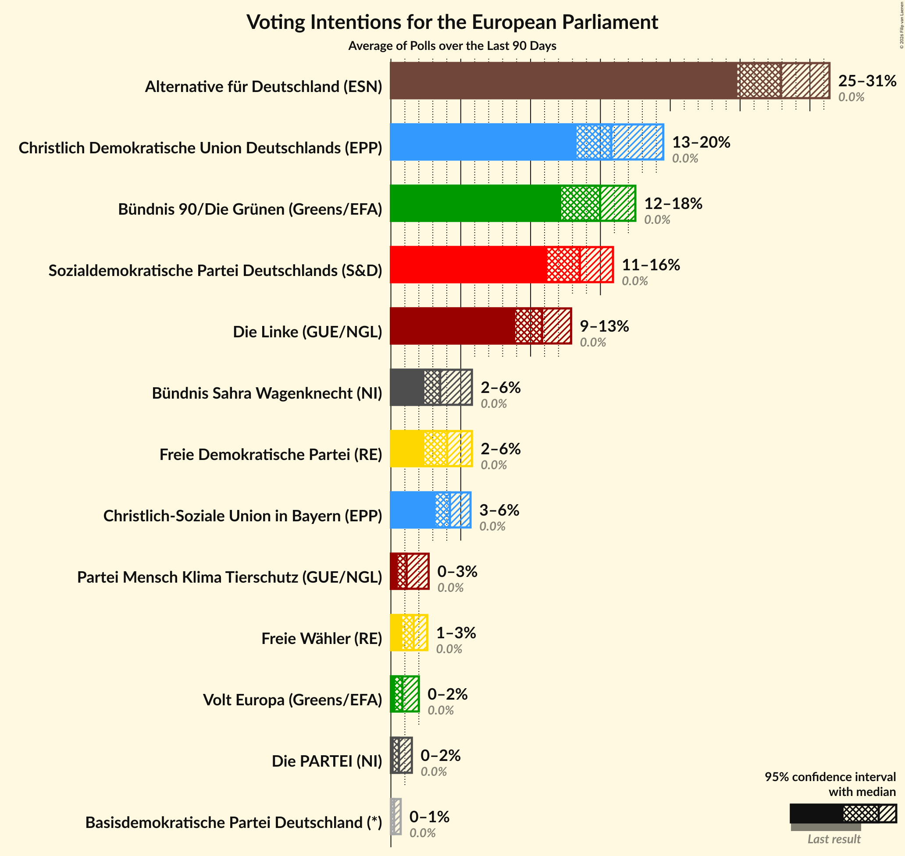
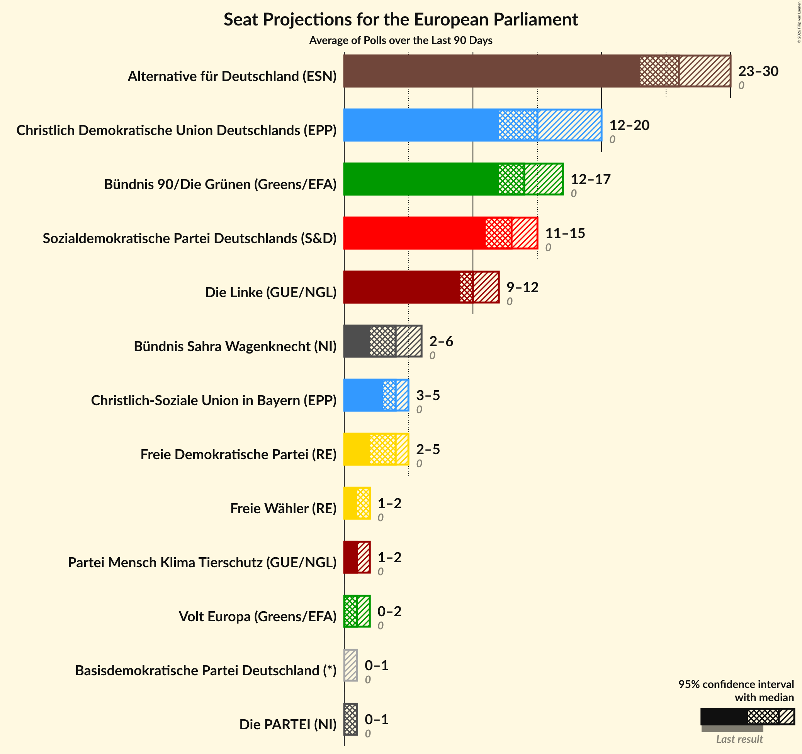
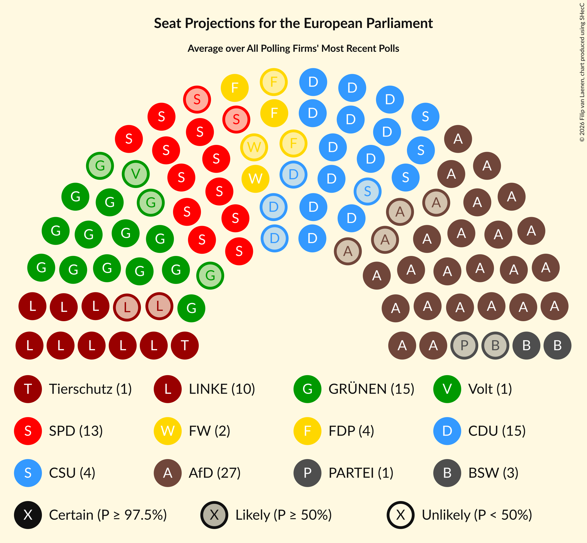
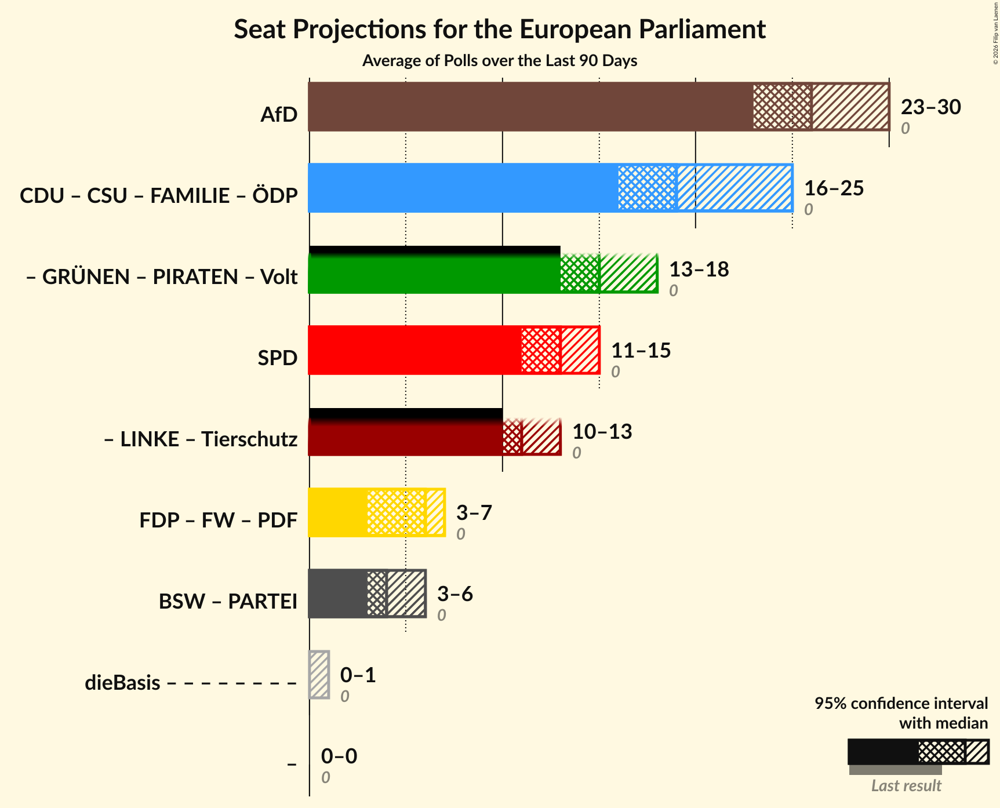

# Overview

The table below lists the most recent polls (less than 90 days old) registered and analyzed so far.

| Period     | Polling firm/Commissioner(s) | LINKE | Tierschutz | GRÜNEN | Volt | PIRATEN | SPD | FDP | FW | PDF | CDU | CSU | FAMILIE | ÖDP | AfD | PARTEI | BSW | dieBasis |
|:----------:|:----------------------------:|:--:|:--:|:--:|:--:|:--:|:--:|:--:|:--:|:--:|:--:|:--:|:--:|:--:|:--:|:--:|:--:|:--:|
| 9 June 2024 | General Election | 0.0%   0 | 0.0%   0 | 0.0%   0 | 0.0%   0 | 0.0%   0 | 0.0%   0 | 0.0%   0 | 0.0%   0 | 0.0%   0 | 0.0%   0 | 0.0%   0 | 0.0%   0 | 0.0%   0 | 0.0%   0 | 0.0%   0 | 0.0%   0 | 0.0%   0 |
| N/A | [Poll Average](average.html) | 9–13%   8–12 | 0–3%   1–2 | 12–18%   12–17 | 0–2%   0–2 | N/A   N/A | 11–16%   11–15 | 2–6%   2–6 | 1–3%   1–3 | N/A   N/A | 13–20%   12–20 | 3–6%   3–5 | N/A   N/A | N/A   N/A | 24–32%   23–30 | 0–2%   0–2 | 2–6%   2–6 | 0–1%   0–1 |
| [2–6 November 2026](2026-11-06-INSAandYouGov.html) | INSA and YouGov   BILD | 8–12%   8–11 | 1–2%   1–2 | 13–17%   13–16 | 0–1%   0–1 | N/A   N/A | 12–16%   11–16 | 4–6%   4–6 | 1–3%   1–2 | N/A   N/A | 13–17%   12–16 | 3–5%   3–5 | N/A   N/A | N/A   N/A | 26–32%   25–29 | 0–1%   0–1 | 2–4%   2–4 | 0–1%   0–1 |
| [2–4 November 2026](2026-11-04-Infratestdimap.html) | Infratest dimap   ARD | 9–13%   9–13 | 1–2%   1–2 | 14–18%   14–18 | 1–2%   1–2 | N/A   N/A | 11–15%   11–14 | 2–4%   2–4 | 2–3%   2–3 | N/A   N/A | 14–18%   13–17 | 3–5%   3–5 | N/A   N/A | N/A   N/A | 25–29%   23–28 | 0–1%   0–2 | 2–4%   2–4 | 0–1%   0–1 |
| [27 October–2 November 2026](2026-11-02-Forsa.html) | Forsa   RTL n-tv | 10–12%   10–12 | 0–1%   1 | 15–19%   15–17 | 0–1%   0–1 | N/A   N/A | 13–16%   12–15 | 3–5%   3–4 | 1–2%   1–2 | N/A   N/A | 14–18%   14–16 | 3–5%   3–5 | N/A   N/A | N/A   N/A | 24–28%   22–27 | 0–1%   0–1 | 3–5%   3–5 | 0%   0 |
| [20–22 October 2026](2026-10-22-ForschungsgruppeWahlen.html) | Forschungsgruppe Wahlen   ZDF | 9–13%   9–12 | 1–2%   1 | 11–15%   11–14 | 0–1%   0–1 | N/A   N/A | 12–16%   11–15 | 2–4%   2–4 | 1–3%   1–2 | N/A   N/A | 16–20%   15–20 | 4–6%   4–5 | N/A   N/A | N/A   N/A | 24–29%   22–26 | 0–1%   0–1 | 4–7%   4–6 | 0–1%   0–1 |
| [14–20 October 2026](2026-10-20-Verian.html) | Verian   FOCUS | 10–13%   9–13 | 1–2%   1–2 | 14–18%   13–17 | 1–2%   1–2 | N/A   N/A | 11–15%   10–15 | 2–4%   2–4 | 1–3%   1–3 | N/A   N/A | 14–18%   13–17 | 3–5%   3–5 | N/A   N/A | N/A   N/A | 26–30%   24–29 | 0–1%   0–1 | 2–4%   2–4 | 0–1%   0–1 |
| [16–19 October 2026](2026-10-19-pollytix.html) | pollytix | 9–13%   9–12 | 0–2%   0–1 | 12–16%   11–16 | 0–1%   0–1 | N/A   N/A | 13–17%   12–16 | 4–6%   4–6 | 1–2%   1–2 | N/A   N/A | 13–17%   12–16 | 3–5%   3–5 | N/A   N/A | N/A   N/A | 26–31%   24–29 | 0–1%   0–1 | 3–5%   3–5 | 0–1%   0 |
| [16–19 October 2026](2026-10-19-YouGov.html) | YouGov | 9–11%   8–12 | 1–2%   1–2 | 14–18%   14–17 | 1–2%   0–2 | N/A   N/A | 12–16%   12–15 | 4–6%   4–6 | 1–3%   1–3 | N/A   N/A | 13–16%   12–15 | 3–5%   3–5 | N/A   N/A | N/A   N/A | 26–30%   25–29 | 0–1%   0–1 | 2–4%   2–4 | 0–1%   0–1 |
| [14–19 October 2026](2026-10-19-GMS.html) | GMS | 8–12%   8–11 | 2–3%   2–3 | 13–17%   12–17 | 1–3%   1–2 | N/A   N/A | 10–14%   10–13 | 2–4%   2–4 | 1–2%   1–2 | N/A   N/A | 13–17%   12–16 | 3–5%   3–5 | N/A   N/A | N/A   N/A | 27–33%   27–32 | 1–2%   1–2 | 2–4%   2–4 | 0–1%   0–1 |
| [2–16 October 2026](2026-10-16-Allensbach.html) | Allensbach | 9–13%   9–12 | 0–1%   0–1 | 12–16%   12–15 | 0–1%   0–1 | N/A   N/A | 12–16%   12–15 | 3–5%   3–5 | 1–2%   1–2 | N/A   N/A | 16–21%   15–20 | 4–6%   4–6 | N/A   N/A | N/A   N/A | 24–30%   24–28 | 0–1%   0–1 | 3–5%   2–5 | 0–1%   0–1 |
| 9 June 2024 | General Election | 0.0%   0 | 0.0%   0 | 0.0%   0 | 0.0%   0 | 0.0%   0 | 0.0%   0 | 0.0%   0 | 0.0%   0 | 0.0%   0 | 0.0%   0 | 0.0%   0 | 0.0%   0 | 0.0%   0 | 0.0%   0 | 0.0%   0 | 0.0%   0 | 0.0%   0 |

Only polls for which at least the sample size has been published are included in the table above.

**Legend:**
+ **Top half of each row:** Voting intentions (95% confidence interval)
+ **Bottom half of each row:** Seat projections for the European Parliament (95% confidence interval)
+ **LINKE:** Die Linke (GUE/NGL)
+ **Tierschutz:** Partei Mensch Klima Tierschutz (GUE/NGL)
+ **GRÜNEN:** Bündnis 90/Die Grünen (Greens/EFA)
+ **Volt:** Volt Europa (Greens/EFA)
+ **PIRATEN:** Piratenpartei Deutschland (Greens/EFA)
+ **SPD:** Sozialdemokratische Partei Deutschlands (S&D)
+ **FDP:** Freie Demokratische Partei (RE)
+ **FW:** Freie Wähler (RE)
+ **PDF:** Partei des Fortschritts (RE)
+ **CDU:** Christlich Demokratische Union Deutschlands (EPP)
+ **CSU:** Christlich-Soziale Union in Bayern (EPP)
+ **FAMILIE:** Familienpartei Deutschlands (EPP)
+ **ÖDP:** Ökologisch-Demokratische Partei (EPP)
+ **AfD:** Alternative für Deutschland (ESN)
+ **PARTEI:** Die PARTEI (NI)
+ **BSW:** Bündnis Sahra Wagenknecht (NI)
+ **dieBasis:** Basisdemokratische Partei Deutschland (*)
+ **N/A (single party):** Party not included the published results
+ **N/A (entire row):** Calculation for this opinion poll not started yet

